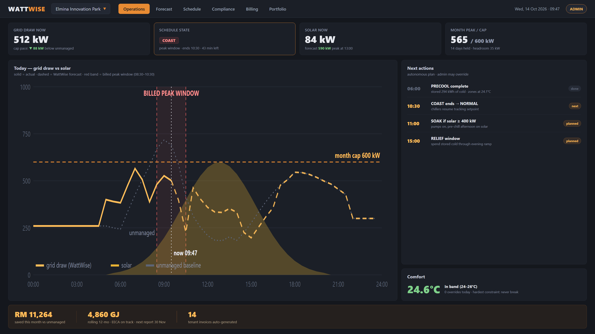
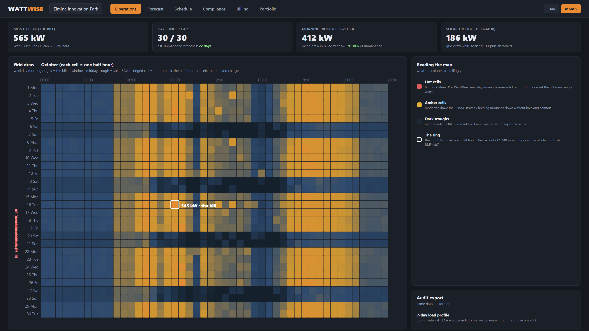
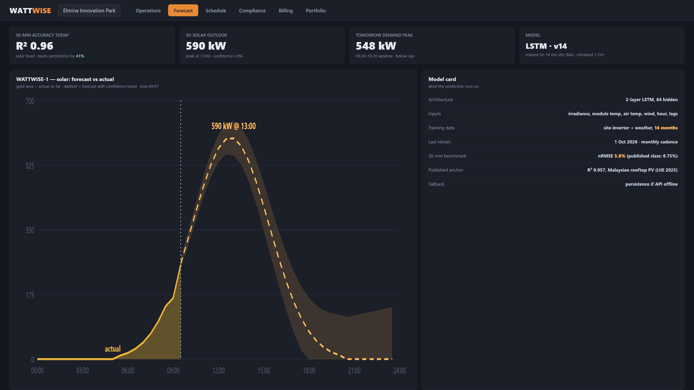
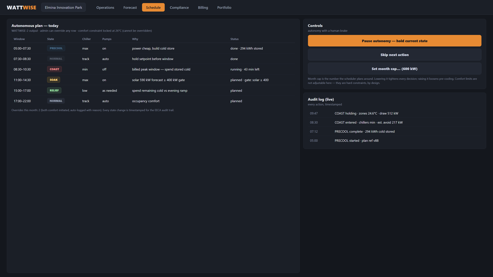
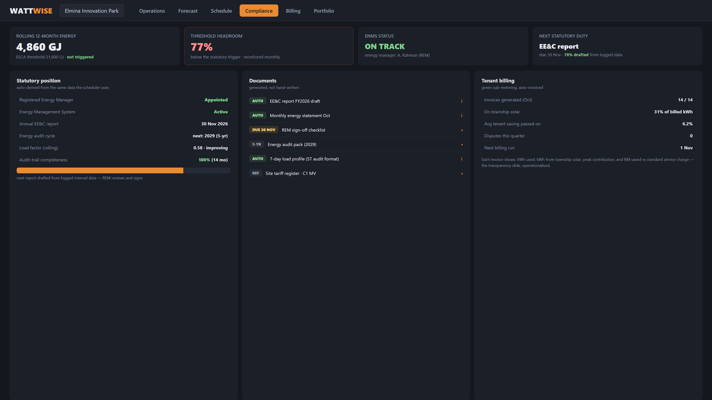

# WattWise - Software UI Plan

The hosting story: what the product looks like, who uses which screen, and how the pieces map to the architecture in `08-TECHNICAL-BUILD-PLAN.md`. All mockups are in `09-assets/` (HTML source + 3200x1800 PNG renders; the HTML is the editable spec, the PNGs are for slides).

**Design language:** dark operations theme matching the deck's identity (near-black #14171d, orange #E88B33 accents, amber #FFBD59 data highlights). One font family. Everything tabular-nums. The product should feel like an ops console, not a marketing site, because the buyer is a facilities team.

---

## 1. Information architecture

Six tabs, one persistent shell (site selector + clock + role badge):

| Tab | Who lives here | What it answers |
|---|---|---|
| **Operations** | facility manager, daily | "what is happening right now?" |
| **Forecast** | the ML-curious, judges | "what will happen next 3h?" |
| **Schedule** | admin with override power | "what will the system do, and can I stop it?" |
| **Compliance** | the Registered Energy Manager | "are we legal, and where are the documents?" |
| **Billing** | finance/tenant manager | "who owes what, and how green was it?" |
| **Portfolio** | SDP leadership view | "how are all townships doing?" (stretch: map + rollup) |

The shell is role-aware: ADMIN sees override controls; a viewer role sees everything read-only. No tenant-facing UI in v1 (they get invoices), no homeowner UI ever (CREAM income is unchanged, deliberately invisible).

## 2. The base screen - Operations

*(source: `09-assets/base-dashboard.html`)*

The daily home, designed around one glance answering five questions:

1. **KPI row**: grid draw now (vs unmanaged), schedule state with countdown, solar now + forecast, month peak vs cap. The middle card is highlighted because the current *state* is the thing that matters minute to minute: in the mockup the building is mid-COAST, 43 minutes left in the billed window.
2. **Main chart**: the same day curve we built for the pitch (actual solid, forecast dashed, unmanaged baseline dotted, solar fill, red billed-peak band, dashed month-cap line). The chart is the product's argument, running live: the audience can *see* the WattWise line duck under the cap while the unmanaged line breaches it.
3. **Next actions rail**: the autonomous plan as a timeline with statuses (done / next / planned). Admin may override; nobody else.
4. **Comfort card**: zone temp with band and override count. Green always, or the whole UI has failed its one job.
5. **Bottom strip**: money saved this month, EECA position, tenant invoices - the three outcomes on one line.

Data contract: everything on this screen comes from the sim loop in `08` (SENSE -> PREDICT -> SCHEDULE -> ACT), so the demo version is literally the model running with a UI skin. No fake numbers bolted on.

## 2b. The month heatmap (Operations, Month toggle)

*(source: `09-assets/heatmap-month.html`)*

The same Operations screen with the **Month** toggle on: a 30 x 48 grid where each cell is one half hour of grid draw, dark trough to red ridge. This is the industry-standard energy-management view and it earns its place four ways:

1. **The argument, visible at a glance.** Weekday mornings show as amber ridges (COAST holding the billed window down) where pre-WattWise they were solid red; midday shows dark troughs where solar SOAK absorbed the surplus. The KPI row quantifies what the eye sees: month peak 565 kW ringed in white ("the bill"), 30/30 days under cap, morning-ridge draw down 38%.
2. **The ring is the pedagogy.** One white-ringed cell out of 1,440 priced the entire month (RM54,862). No chart explains Maximum Demand faster than that.
3. **EECA evidence for free.** The same grid exports as the 7-day load profile in ST's audit format (30-min interval, load factor derivable) - the right rail's "Audit export" card is one click, not a project.
4. **It's the natural home screen for the REM.** The Registered Energy Manager's statutory duties are literally about this data; giving them the month as one picture makes WattWise their daily tool, not a report generator they visit quarterly.

In the demo this view is generated by the same simulation loop (one month, seeded), so Day view and Month view stay numerically consistent with each other and with the pitch figures.

*(source: `09-assets/forecast-view.html`)*

WATTWISE-1 made visible: actual-so-far in gold, forecast dashed with a confidence band that widens with horizon (honest uncertainty, on display rather than hidden), KPIs for today's 30-min accuracy vs persistence, and a **model card** panel - architecture, inputs, training window, last retrain, benchmark vs published class. The model card exists because judges and engineers both ask the same question ("what exactly is running?") and the answer should be a glance, not a paragraph.

## 4. Schedule view

*(source: `09-assets/schedule-view.html`)*

WATTWISE-2 as a table a facilities manager can read: windows, states, equipment, the *why* column (every row explains itself), and status. The right rail is "autonomy with a human brake":

- **Pause autonomy / skip next action / set month cap** - the only three controls an admin needs.
- The comfort constraint is visibly **not adjustable** - locked at 26C, stated on the screen. This is a design decision doing argumentative work: it proves comfort is a hard constraint, not a setting someone could trade away.
- **Audit log** at the bottom right: every action timestamped. This same feed is the EECA audit trail, which is why Compliance is nearly free to build.

## 5. Compliance + Billing view

*(source: `09-assets/compliance-view.html`)*

The retention screens. Three panels:

- **Statutory position**: REM appointed, EnMS active, next report date, audit cycle, rolling load factor, audit-trail completeness. Auto-derived from the same logged data the scheduler produces - the pitch's "compliance on autopilot" shown as rows and a progress bar, with the REM as reviewer, not data-entry.
- **Documents**: the generated artifacts (EE&C report draft, monthly statements, 7-day load profile in ST audit format) with download affordances.
- **Tenant billing**: invoices generated, share on township solar, saving passed through, disputes. The invoice contents (kWh used, township-solar kWh, peak contribution, RM saved) are the "transparent billing" slide operationalised.

## 6. UX principles (what makes this WattWise and not a generic EMS)

1. **The state machine is the UI's spine.** PRECOOL / COAST / SOAK / RELIEF / NORMAL appear as colours, pills and badges everywhere, so a user learns the model in one sitting. Every screen answers "what mode are we in and why".
2. **Autonomy with a brake, never a steering wheel.** The system acts; humans pause or bound it (month cap). No one hand-schedules chillers - that's the bug being fixed, not a feature to preserve.
3. **Comfort is displayed as a lock, not a slider.** The constraint is architecturally un-overridable and the UI says so.
4. **Every number traces.** Charts show actual vs unmanaged vs cap because the product's value is the *gap*; the model card shows lineage; the audit log is forever.
5. **Ops-console tone.** Dense, dark, quiet. The buyer is a facilities team at 7am, not a browser at a tradeshow.

## 7. Build plan for the UI (maps to `08` Part 4)

| Phase | What | Stack |
|---|---|---|
| Demo (by 14 Nov) | Operations + Schedule screens driven by the sim loop; static data for others | single-page HTML+JS (adapt these mockups), FastAPI `/state` `/forecast` `/plan` |
| Pilot (post-hackathon) | All six tabs, role login, real meter/inverter feeds, alerting | same front end, real SENSE layer, sqlite->postgres |
| Product | Portfolio rollup, multi-site, tenant invoice PDFs, REM sign-off workflow | whatever survives contact with SDP's actual BMS |

The mockups double as the wireframe spec: each HTML file is self-contained, so the demo UI can be grown directly from them rather than re-specified.

## 8. Assets in this folder

| File | What |
|---|---|
| `09-assets/base-dashboard.png` | Operations screen (the base UI) |
| `09-assets/forecast-view.png` | WATTWISE-1 forecast + model card |
| `09-assets/schedule-view.png` | WATTWISE-2 plan, controls, audit log |
| `09-assets/compliance-view.png` | EECA compliance + tenant billing |
| `09-assets/heatmap-month.png` | Month heatmap view (Operations, Month toggle) |
| `09-assets/*.html` | editable sources for all five |
